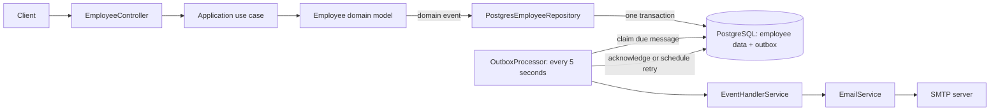
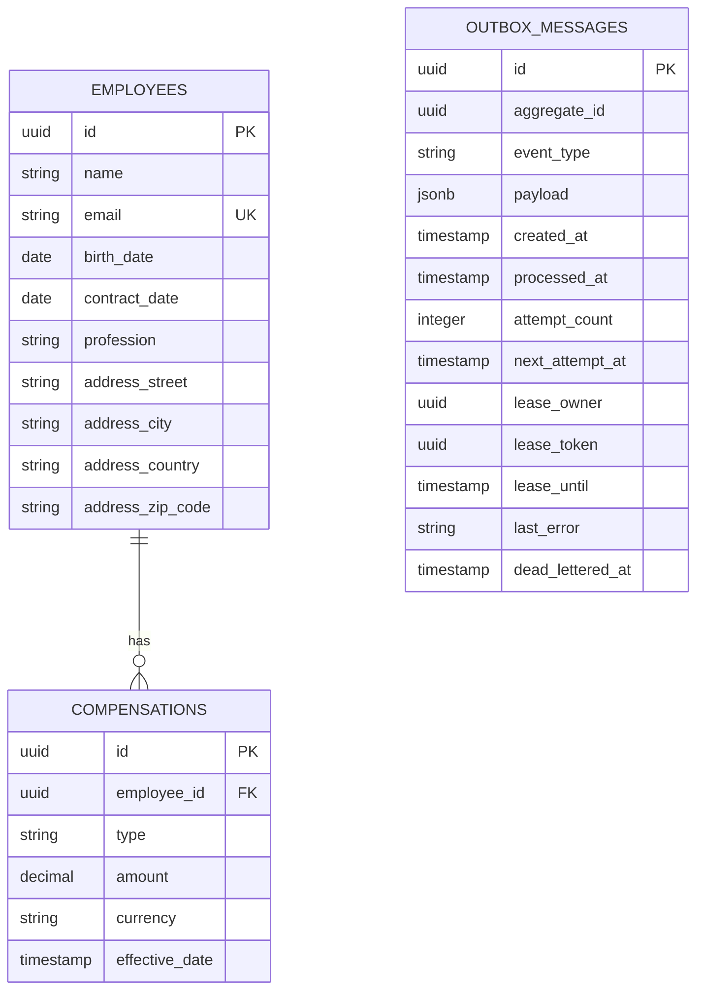

# Employee Compensation API

A NestJS REST API for managing employee profiles and compensation updates. The project uses a layered architecture, PostgreSQL persistence through TypeORM, and a transactional outbox to send email
notifications after employee and compensation changes.

## Features

- Create employees and retrieve employee details.
- Browse employees with pagination.
- Add or update an employee's base salary, bonus, or allowance.
- Validate employee and compensation input at the API and domain layers.
- Persist domain events in an outbox in the same transaction as the employee change.
- Process outbox messages asynchronously with leases, retries, and dead-letter tracking.
- Return consistent JSON error responses with request IDs where available.
- Browse the API through Swagger.

## Architecture

The code is organized by responsibility:

| Layer             | Responsibility                                                                             |
| ----------------- | ------------------------------------------------------------------------------------------ |
| `presentation/`   | HTTP controllers and API routing                                                           |
| `application/`    | Use cases and mapping to response DTOs                                                     |
| `domain/`         | Employee and compensation entities, value objects, domain events, and repository contracts |
| `infrastructure/` | PostgreSQL/TypeORM, outbox processing, SMTP email, logging, and Swagger                    |
| `shared/`         | DTOs and shared pagination types                                                           |

### Request and notification flow



Employee creation and compensation updates do **not** send email in the HTTP request. The use case changes the domain model, and the repository saves the data and its outbox event atomically. The
background processor later claims the message, dispatches it by event type, and acknowledges it after the email handler succeeds.

### Persistence model



`outbox_messages.aggregate_id` identifies the employee aggregate but is not a foreign key. This allows the outbox to retain an event independently of the employee row.

### Outbox delivery behavior

- The processor polls every 5 seconds and handles up to 20 messages per invocation, claiming one message at a time.
- PostgreSQL row locking with `SKIP LOCKED` prevents concurrent workers from claiming the same available message.
- A claim has a 5-minute lease, renewed every 30 seconds during a long-running delivery.
- Failed deliveries are retried with exponential backoff: a 5-second initial delay, capped at 1 hour, for up to 8 attempts.
- Messages that exhaust their attempts receive `dead_lettered_at` and are not retried automatically.
- Delivery is **at-least-once**, not exactly-once. If SMTP accepts an email and the process stops before the database acknowledgement, a retry can send a duplicate. SMTP does not provide a general
  idempotency key.

Dead-lettered messages currently require operator intervention; there is no API or UI for inspecting or requeueing them.

## API

The local API listens on port `3000` by default. Interactive Swagger documentation is available at [`/api`](http://localhost:3000/api).

### `POST /employees`

Create an employee. Dates use `YYYY-MM-DD`; employees must be at least 18 years old, and the contract date cannot be in the future.

Request:

```json
{
  "name": "Alex Johnson",
  "email": "alex.johnson@example.com",
  "birthDate": "1990-08-26",
  "contractDate": "2020-08-28",
  "profession": "Engineer",
  "address": {
    "street": "16 Lotus Street",
    "city": "Belo Horizonte",
    "country": "Brazil",
    "zipCode": "45898"
  }
}
```

Success: `201 Created`, returning the employee UUID as a string.

### `GET /employees`

Return a paginated employee list.

| Query parameter | Default | Constraints               |
| --------------- | ------- | ------------------------- |
| `pageNumber`    | `1`     | Positive integer          |
| `pageSize`      | `10`    | Integer from `1` to `100` |

Example: `GET /employees?pageNumber=1&pageSize=10`

```json
{
  "items": [
    {
      "id": "a06a98d5-0c66-49f8-a525-7f8ac25612f8",
      "name": "Alex Johnson",
      "email": "alex.johnson@example.com",
      "birthDate": "1990-08-26",
      "contractDate": "2020-08-28",
      "profession": "Engineer",
      "address": {
        "street": "16 Lotus Street",
        "city": "Belo Horizonte",
        "country": "Brazil",
        "zipCode": "45898"
      }
    }
  ],
  "pageNumber": 1,
  "pageSize": 10,
  "totalPages": 1,
  "totalRecords": 1
}
```

### `GET /employees/:id`

Return an employee and their compensations. The path parameter must be a UUID v4.

```json
{
  "id": "a06a98d5-0c66-49f8-a525-7f8ac25612f8",
  "name": "Alex Johnson",
  "email": "alex.johnson@example.com",
  "birthDate": "1990-08-26",
  "contractDate": "2020-08-28",
  "profession": "Engineer",
  "address": {
    "street": "16 Lotus Street",
    "city": "Belo Horizonte",
    "country": "Brazil",
    "zipCode": "45898"
  },
  "compensations": [
    {
      "id": "417be850-7aae-4bc4-9345-8ace2aa242b1",
      "type": "BASE_SALARY",
      "amount": 75000,
      "currency": "USD",
      "effectiveDate": "2026-01-01T00:00:00.000Z"
    }
  ]
}
```

Returns `404 Not Found` when the employee does not exist.

### `POST /employees/:id/compensations`

Add a compensation or update the employee's existing compensation of the same type. Amounts must be positive.

Request:

```json
{
  "type": "BASE_SALARY",
  "amount": 75000,
  "currency": "USD"
}
```

Allowed types: `BASE_SALARY`, `BONUS`, `ALLOWANCE`. Success: `200 OK`, returning the employee UUID as a string.

### Error responses

Errors use a consistent JSON shape. Validation errors return `400`, missing employees return `404`, duplicate-email conflicts return `409`, and unexpected errors return `500` without exposing internal
details.

```json
{
  "status": "error",
  "statusCode": 409,
  "error": "Conflict",
  "message": "An employee with this email already exists.",
  "timestamp": "2026-11-23T12:00:00.000Z",
  "path": "/employees",
  "requestId": "request-123"
}
```

`requestId` is optional.

## Getting started

### Requirements

- Node.js 20 or later
- PostgreSQL
- An SMTP account for email notifications

### Install and configure

```bash
npm install
```

Create a local `.env` file with your database and SMTP settings:

```dotenv
DATABASE_URL=postgresql://<user>:<password>@localhost:5432/employee_compensation
SMTP_HOST=<smtp-host>
SMTP_PORT=587
SMTP_USER=<smtp-user>
SMTP_PASS=<smtp-password>

# Optional
PORT=3000
DB_POOL_MAX=10
NODE_ENV=development
LOG_LEVEL=debug
```

Never commit `.env` or paste real credentials into tickets or logs. `.env` files are ignored by Git.

### Run the API

```bash
npm run start:dev
```

The application starts at `http://localhost:3000`; Swagger is at `http://localhost:3000/api`.

## Tests and build

```bash
npm test -- --runInBand
npm run test:e2e -- --runInBand
npm run build
```

The PostgreSQL/outbox integration suite requires a **dedicated test database**. It uses TypeORM synchronization and removes unprocessed outbox rows between tests.

```bash
TEST_DATABASE_URL=postgresql://<user>:<password>@localhost:5432/employee_compensation_test \
  npm run test:integration -- --runInBand
```

Do not point `TEST_DATABASE_URL` at a development or production database.

## Production considerations

- The current TypeORM connection enables `synchronize: true` for development convenience. Use reviewed database migrations and disable synchronization in production.
- The API currently has no authentication or authorization. Add access controls before exposing employee data publicly.
- Configure and validate SMTP credentials through a secret manager or deployment environment.
- Monitor outbox retries and dead-lettered messages; define an audited operational requeue process.
- SMTP delivery is at-least-once and can result in duplicate emails in the crash window described above.

## Author

**Emmanuel F.**
